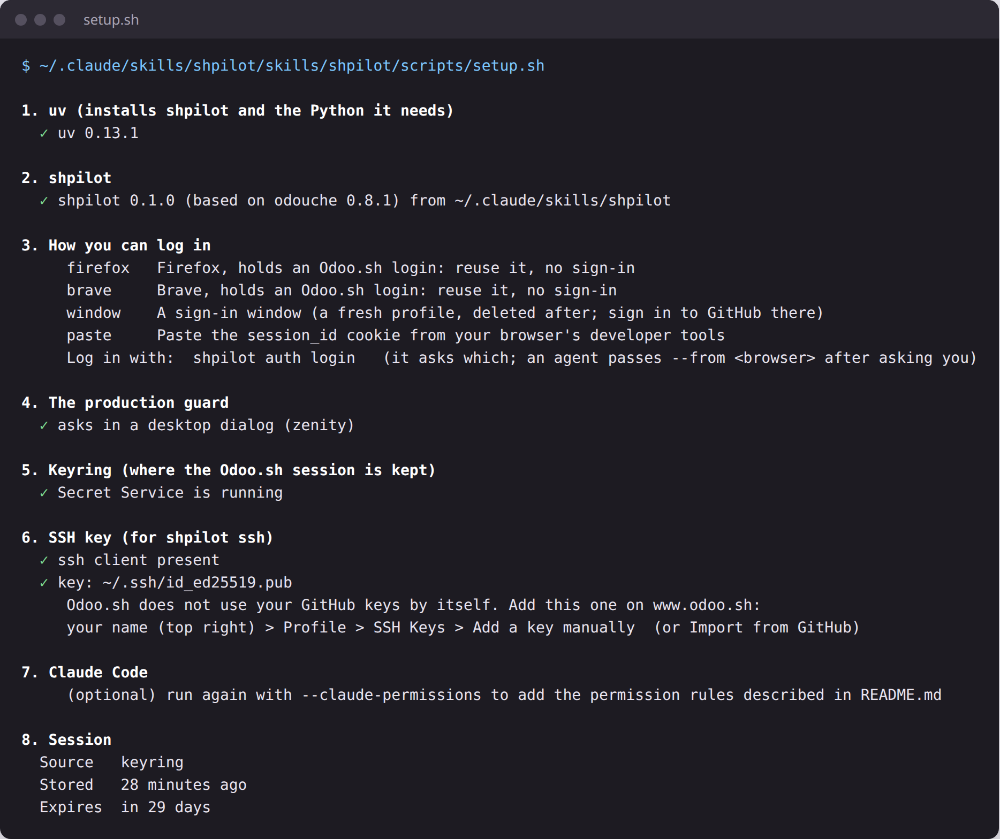
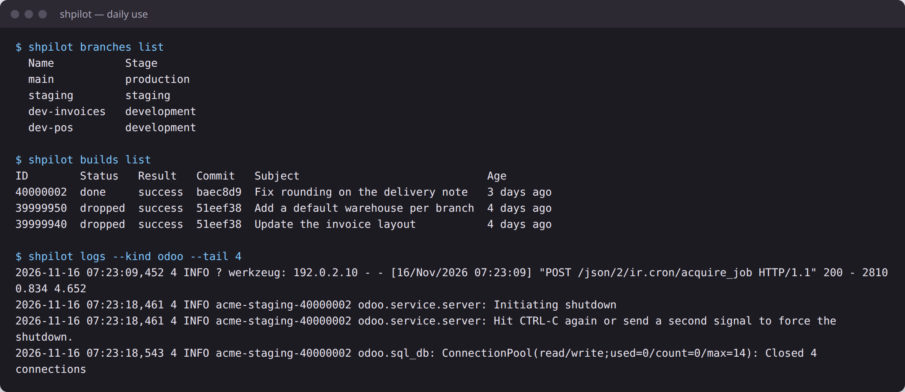
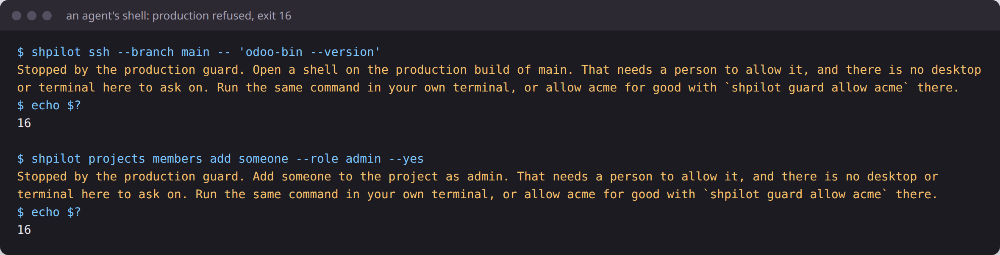
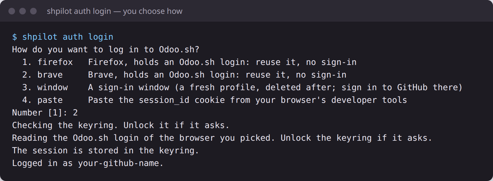
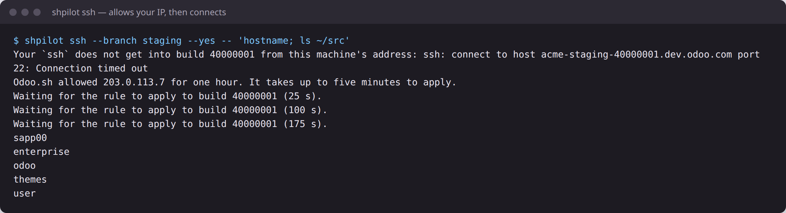
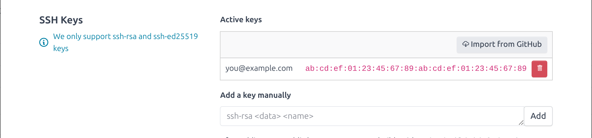

# shpilot

[](https://github.com/Mahmoudd777/shpilot/actions/workflows/ci.yml)
[](LICENSE)

Odoo.sh from the terminal, and from AI coding agents such as Claude Code. Wait for a build after a
push, read its install and server logs, follow a log live, list backups, open SSH on a staging
build, and click-test a staging build in a headless browser as any of its users. Every change to
production, and every change to a whole project, waits for a person to allow it in a dialog on the
desktop; a command an agent runs cannot answer it, so the change stops with nothing sent.

shpilot is built on [odouche](https://github.com/avanserv/odouche) by Avanserv, which did the hard
part. See [Credits](#credits).

```bash
uv tool install git+https://github.com/Mahmoudd777/shpilot
shpilot auth login
git push && shpilot builds watch || shpilot logs
```



> shpilot is unofficial and not affiliated with Odoo S.A. "Odoo" and "Odoo.sh" are trademarks of
> Odoo S.A. Odoo.sh has no public API: shpilot uses what the Odoo.sh web page uses. When Odoo.sh
> changes, a command can stop working. It then fails with exit 6 and says so. It does not return
> wrong data.

## What it does

Inside a git checkout that Odoo.sh builds, the project and branch come from git. Anywhere else, pass
`--project <name> --branch <branch>`.

```bash
shpilot projects list                      # your Odoo.sh projects
shpilot branches list                      # each branch and its stage
shpilot builds list                        # newest first
shpilot builds watch                       # waits for the latest build; exit code is its result
shpilot logs                               # end of the latest build's log
shpilot logs --kind odoo --all | grep -nE "ERROR|CRITICAL|Traceback"
shpilot logs --kind odoo -f --timeout 120  # follow the server log while you reproduce a bug
shpilot builds mails                       # mails a staging or development build caught
shpilot backups list
shpilot ssh --branch staging               # a shell on the staging build
```

Add `--format json` before the group (`shpilot --format json builds list`) for output a script can
parse. `shpilot builds watch` exits 0 on success, 20 on a failed build, 21 on warnings, so this works
as one line:

```bash
git push && shpilot builds watch || shpilot logs --all | grep -n -B5 -A30 Traceback
```



Changes are there too: `builds rebuild`, `backups create|download|pull`, `branches move`,
`branches settings set`, `projects settings set` (including the IP allow list), `projects members
add|role`. The full reference, with every exit code, is [docs/cli.md](docs/cli.md), or
`shpilot <group> <command> --help`.

## The production guard

These wait for a person before anything is sent:

- every change to a production branch: rebuild, backup, branch settings, moving a branch
- every change to a whole project: its settings, its IP allow list, its members
- downloading or copying a production backup to this machine
- `shpilot ssh` on a production build

Listing and reading (builds, logs, mails, the backup list) is never guarded. Nothing on a staging or
development branch is guarded; a branch whose stage shpilot does not recognise counts as production.

The guard asks in this order:

1. A desktop dialog (zenity or kdialog on Linux, osascript on macOS) with **Once**, **Always for
   \<project\>** and **No**.
2. The terminal the command was started from (`/dev/tty`, never stdin), when there is no desktop.
3. Nowhere: the command exits **16** and nothing is sent. An AI agent's shell has no terminal, so
   when you are not at the desktop, this is what the agent gets.



"Always" is stored per project in `~/.config/shpilot/guard.json` (macOS: `~/Library/Application
Support/shpilot/`; Windows: `shpilot\guard.json` in the AppData folder Windows reports). The path
never comes from the environment (`$HOME`, `$XDG_CONFIG_HOME`, `%APPDATA%`), which the caller can set. The dialog programs are
run by their system paths only (Windows PowerShell from System32), never found on `PATH`.

```bash
shpilot guard show           # projects that no longer ask
shpilot guard allow acme     # stop asking for acme; the guard asks you to confirm once
shpilot guard allow '*'      # stop asking for every project, the same way
shpilot guard ask acme       # ask again for acme (or '*' for every project); needs no yes
```

**Always allow, so an agent does not ask you every time.** Click **Always for \<project\>** in the
dialog the first time, or run `shpilot guard allow <project>` (or `'*'`) once and confirm. From then
on production changes on that project go ahead without the dialog, until `shpilot guard ask`. An
agent can start `shpilot guard allow` for you, but only your click confirms it. If you also added the
Claude Code rules below, Claude Code asks before such commands too; answer its prompt with "don't
ask again" for the ones you want to run freely.

What the guard stops: an accidental change, and an injected one run as written, the command an
agent runs because a build log, a mail or a web page told it to. What it does not stop: anything set
on getting around it. An agent whose shell runs without asking you can be led to edit `guard.json`,
fake a terminal, or use the stored session directly, and once Odoo.sh allowed this machine's IP
(staging SSH does), plain `ssh` reaches production without shpilot. Keep the agent's shell on
prompts: the `--claude-permissions` rules below ask before raw `ssh`/`rsync` to Odoo.sh.
[docs/security.md](docs/security.md) has the details.

## Logging in

You choose how. shpilot never picks a way for you.

```bash
shpilot auth browsers                  # browsers here, and which hold an Odoo.sh login
shpilot auth login --from firefox      # reuse that browser's Odoo.sh login
shpilot auth login --window            # sign in with GitHub in a fresh window
shpilot auth login --paste             # paste the session_id cookie, without echo
```

- **`--from <browser>`** (firefox, chrome, chromium, brave, edge, vivaldi, opera) reads one cookie,
  `session_id` of `www.odoo.sh`, from that browser, and nothing else. `auth browsers` lists them
  without decrypting anything. Chromium-family browsers encrypt the cookie; shpilot decrypts it in
  its own process, and the keyring may ask you to unlock it first.
- **`--window`** opens a browser window with a fresh profile, in which you sign in to Odoo.sh with
  GitHub. The profile is deleted afterwards. It finds Chrome, Chromium, Edge, Brave, Vivaldi and
  Opera, including Brave and Chromium installed as Ubuntu snaps. Set `SHPILOT_BROWSER` to a name or
  path to choose one.
- **`--paste`** asks for the cookie in a prompt that does not echo. Use it over SSH or in a
  container.

With no option, at a terminal, `shpilot auth login` shows a numbered menu. Without a terminal (an
agent's shell) it exits 2 and lists the choices, so the agent has to ask you.



Each way, the session is checked with Odoo.sh before it is stored. What shpilot keeps is that
session alone, in your operating system's keyring, for 30 days at most. Your GitHub password and
token never pass through shpilot. `shpilot auth status` shows the session; `shpilot auth logout`
ends it on Odoo.sh and removes it.

## SSH

```bash
shpilot ssh --branch staging
shpilot ssh --branch staging --yes -- 'odoo-bin --version'
```

When the build keeps your machine out, shpilot offers to press Odoo.sh's "Allow my IP" for one hour
(`--yes` presses it without asking). The rule takes a few minutes to apply; shpilot retries
meanwhile, then hands over to your own `ssh`.



`Permission denied (publickey)` means your public key is not on your Odoo.sh profile. Odoo.sh does
not use your GitHub keys on its own: on www.odoo.sh, open your name (top right) > Profile > SSH Keys
and add it.



## Browser tests on staging

`shpilot web-session` makes a web session on a staging or development build as any user, with no
password, so a headless browser can test a screen as that user.

```bash
shpilot web-session login --branch staging --out ./sessions admin 7   # logins or user ids
shpilot web-session logout --branch staging --out ./sessions
shpilot web-session logout --branch staging --out ./sessions --all    # every session shpilot made there
```

- The session is created over SSH by `odoo-bin shell` on the build. It skips the login page, so
  there is no password, no second factor and no login record.
- Production, and any stage shpilot does not recognise, is refused in code (exit 9). The guard
  cannot allow it.
- The session id is never printed. Each file (`<dir>/<uid>.session`) is mode 600, in a directory of
  mode 700. Log out when done; `--all` also removes sessions Odoo renamed since, and leftovers.

The Claude Code skill wraps this in `browse.sh`, which logs in, drives headless Chromium with
[Playwright](https://playwright.dev) through a small steps file, writes screenshots and a
`report.json` (JS errors, failed requests), and always logs out:

```bash
skills/shpilot/scripts/browse.sh <project> <branch> <uid|login> steps.js [outdir]
```

It needs Node.js and Playwright (`npm install -g playwright && npx playwright install chromium`).

A staging build holds a copy of production's data. Screenshots from these tests show customer data:
keep them out of anything you share.

## Install

### Claude Code plugin

```text
/plugin marketplace add Mahmoudd777/shpilot
/plugin install shpilot@shpilot
```

Then ask Claude to set up shpilot. The skill runs `skills/shpilot/scripts/setup.sh`, which installs
the `shpilot` command with [uv](https://docs.astral.sh/uv/) from that checkout, with exact-pinned
dependencies, and checks the machine: browsers, keyring, the guard's dialog, your SSH key.

### Clone into Claude Code's skills

```bash
git clone https://github.com/Mahmoudd777/shpilot ~/.claude/skills/shpilot
~/.claude/skills/shpilot/skills/shpilot/scripts/setup.sh
```

### The command alone, without Claude Code

```bash
uv tool install git+https://github.com/Mahmoudd777/shpilot
shpilot --version
```

Python 3.12 or newer. uv fetches one if needed.

### Claude Code permissions (optional)

```bash
skills/shpilot/scripts/setup.sh --claude-permissions
```

This adds rules to `~/.claude/settings.json`, after saving a backup next to it:

- **allow**: the read-only commands (`auth status`, `auth browsers`, `projects list`, `builds list`,
  `builds watch`, `logs`, `backups list`, `guard show`, and similar)
- **ask**: `shpilot ssh`, `web-session`, `auth login`, `auth logout`, every command that changes
  something (including `guard allow` and `guard ask`), and plain `ssh`, `scp`, `rsync` and `sftp` to
  an `odoo.com` host
- **deny**: Claude Code's edit tools on the guard's file (a shell command is covered by the ask
  rules only as far as Claude Code's prompts go)

They sit in front of the guard and do not replace it.

## Where it works

| | Linux | macOS | Windows |
| --- | --- | --- | --- |
| The `shpilot` command, every read and change | yes | yes | yes |
| Production guard | desktop dialog (zenity, kdialog), else terminal | desktop dialog (osascript), else terminal | Windows dialog (Windows PowerShell), else console |
| Guard's "Always" kept in | `~/.config/shpilot/` | `~/Library/Application Support/shpilot/` | the AppData folder Windows reports |
| Log in `--from` a browser | Firefox, Chrome, Chromium, Brave, Edge, Vivaldi, Opera (snaps too) | the same | Firefox only (Chromium binds its key to the browser on Windows) |
| Log in `--window` | yes | yes | no: use `--from firefox` or `--paste` |
| Session kept in | Secret Service (GNOME Keyring, KWallet) | Keychain | Credential Locker |
| `shpilot ssh`, `backups pull` | hands over to `ssh` | hands over to `ssh` | prints the `ssh` command to run (exit 14) |
| `web-session`, `browse.sh` (browser tests) | yes | yes | in WSL (they need the `ssh` handover) |
| `setup.sh`, `browse.sh` | bash | bash | Git Bash (the shell Claude Code uses on Windows), or WSL |

Every push runs the whole test suite, `setup.sh` and a smoke test of the installed command on Linux,
macOS and Windows ([CI](.github/workflows/ci.yml)). The dialogs and browser logins have been used by
hand on Linux; on macOS and Windows they are covered by tests that simulate the system, not yet by a
person clicking. Reports from those systems are welcome.

The skill works the same in every Claude Code: the desktop app's Code tab, the `claude` command in a
terminal, and the VS Code and JetBrains extensions. They read the same `~/.claude/skills` folder and
the same plugins, and run the same `shpilot` command.

## Troubleshooting

| What you see | What it means, and what to do |
| --- | --- |
| Exit 16, "Stopped by the production guard" | A production or project-wide change, with no desktop dialog and no terminal to ask on. Run the same command in your own terminal, or be at the desktop to answer the dialog. Nothing was sent. |
| `Permission denied (publickey)` on `shpilot ssh` | Your public key is not on Odoo.sh. www.odoo.sh > your name > Profile > SSH Keys. |
| Exit 8 on `shpilot ssh` | The IP rule did not apply within ten minutes. Run it again. |
| Exit 11, no usable keyring | Linux: install and unlock a Secret Service provider (`sudo apt install gnome-keyring`). Headless or CI: set `SHPILOT_SESSION`. shpilot never falls back to a file. |
| Exit 3 | No session, or it expired. `shpilot auth login`. |
| Exit 2 from `shpilot auth login` in an agent | Expected: the agent must ask you which way to log in, then pass `--from`, `--window` or `--paste`. |
| "Odoo.sh no longer accepts the login \<browser\> holds" | Log in to www.odoo.sh in that browser again, or choose another way. |
| Exit 6 | Odoo.sh answered in a shape shpilot does not read: Odoo.sh changed. Please [open an issue](https://github.com/Mahmoudd777/shpilot/issues) with the command, without any output that names a client. |
| Exit 9 from `web-session` | That branch is production, or its stage is unknown. Web sessions are for staging and development only. |

Every exit code is in [docs/cli.md](docs/cli.md#exit-codes). What shpilot reads, stores and sends is
in [docs/security.md](docs/security.md); to report a vulnerability, see [SECURITY.md](SECURITY.md).

## Credits

shpilot is [odouche](https://github.com/avanserv/odouche) 0.8.1 by
[Avanserv](https://github.com/avanserv), bundled and renamed, with additions. odouche did the hard
part: it worked out Odoo.sh's private API, call by call, and covers it with about 2,600 tests. All
2,639 of its tests pass on this bundle, and our additions bring the suite to over 2,700. Thank you to
the odouche authors for building it with such care and publishing it under the MIT license.
[NOTICE.md](NOTICE.md) lists what came from odouche.

Thank you also to [Abdallah Abdelsabour](https://github.com/abdallah-abdelsabour), whose post
introduced odouche to us, and whose fork,
[odoo-sh-toolkit](https://github.com/abdallah-abdelsabour/odoo-sh-toolkit), explored the IP allow
problem.

Our additions are the production guard, the browser-login choice, `shpilot web-session`, the Claude
Code skill and plugin, and `browse.sh`. [CHANGELOG.md](CHANGELOG.md) has the list.

## License

MIT. See [LICENSE](LICENSE). The odouche code keeps its own MIT license, in
[LICENSE.odouche](LICENSE.odouche).
